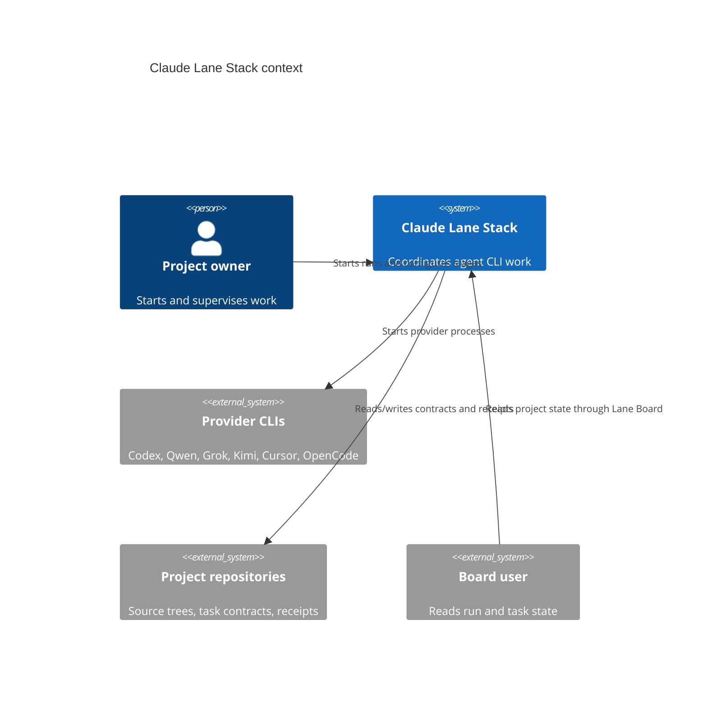
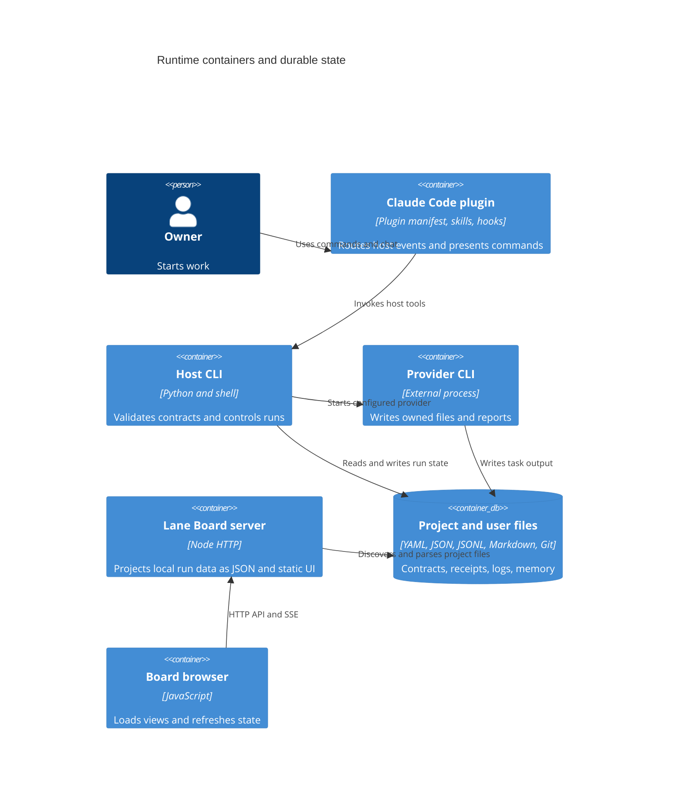
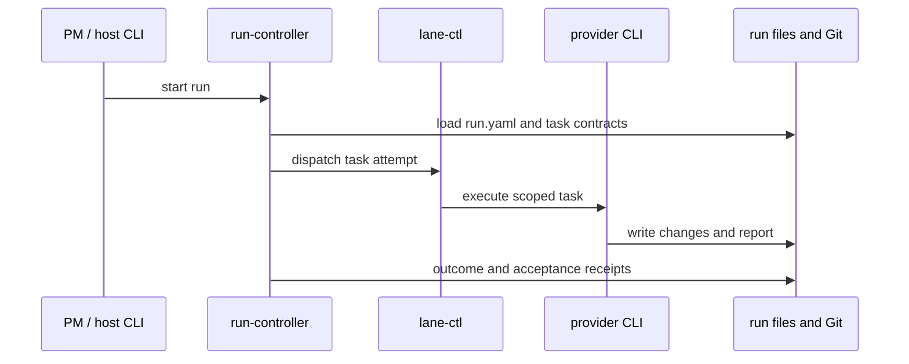
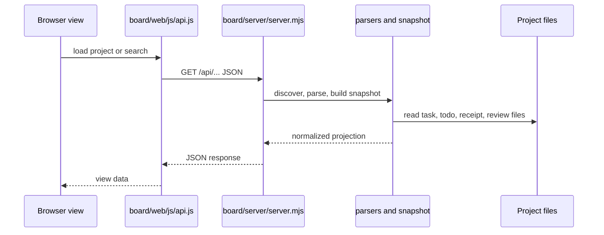

# Claude Lane Stack architecture

TL;DR: Host CLIs and plugin hooks assemble task context, run provider processes, and persist verifiable receipts; the read-only Lane Board projects files from project workspaces into a local HTTP UI (`bin/run-controller:734-808`, `bin/run-controller:1310-1367`, `board/server/server.mjs:106-230`).

## System Context

The owner interacts with a host CLI or Claude Code. Provider CLIs execute scoped tasks; Git worktrees and files carry run state. The optional board reads project files and serves a browser UI (`bin/lane-pm:1-25`, `bin/pipeline_stages.py:205-300`, `board/server/server.mjs:106-230`).

## Containers

The server factory binds request handlers and a project watcher; the start function starts the watcher before listening and stops it if listen fails (`board/server/server.mjs:106-108`, `board/server/server.mjs:233-253`). The default host is loopback, the default port is 4311, and invalid ports fall back to 4311 (`board/server/server.mjs:233-246`).

## Building Blocks

- Host run lifecycle: controller, contract validation, provider dispatch, and receipt handling (`bin/run-controller:734-808`, `bin/run-controller:811-840`, `bin/run-controller:566-594`, `bin/run-validate:410-450`).
- Stage defaults and allowed providers: [ROUTING.md](ROUTING.md), implemented in `bin/pipeline_stages.py:33-50` and `bin/pipeline_stages.py:205-300`.
- Plugin hooks: [HOOKS.md](HOOKS.md); plugin metadata is in `plugins/lane-stack/.claude-plugin/plugin.json:1-19`, while hook implementations live in plugin hook files such as `plugins/lane-stack/hooks/jev-router.ts:105-129`.
- Durable run contracts and receipts: [data model](data-model.md), with schema validation in `bin/run-validate:348-421`.
- Lane Board server and browser views: `board/server/server.mjs:106-230`, `board/web/js/api.js:29-48`.
- Project memory hub-first search and local-index fallback: `bin/lane_memory.py:412-417`, `bin/lane_memory.py:634-680`, `bin/lane_memory_hub.py:100-165`.
- Winnow response filtering: `plugins/lane-stack/winnow/sidecar/src/winnow/serve.py:92-120`.

## Key Flows

### Run dispatch and completion

`run-controller` requires a schema-v2 run, validates its run contract, then manages task pipelines and records terminal outcomes (`bin/run-controller:127-159`, `bin/run-controller:734-808`, `bin/run-controller:811-840`, `bin/run-controller:566-594`). Acceptance artifacts are separately checked against schema, task hash, attempt, and state (`bin/run-validate:348-398`).

### Board read path

The server discovers repositories, builds snapshots for searches or project detail, and serializes JSON; browser API calls map project, todo, task, review, and search requests to `/api` routes (`board/server/server.mjs:126-194`, `board/web/js/api.js:29-48`). Discovery performs a breadth-first walk from configured roots, includes a directory only when it has a real `.git` directory and `.agents/runs` directory, prunes `.agents`, `.git`, `node_modules`, and `postgres_data` from traversal, stops descending at `maxDepth` (default 3), deduplicates paths, and sorts results by path (`board/server/lib/discover.mjs:5-5`, `board/server/lib/discover.mjs:38-70`).

Board routes accept GET and HEAD for health, projects, search, todos, tasks, reviews, and project detail; events use GET and Server-Sent Events (`board/server/server.mjs:121-198`). `/api/events` sends refresh events and 25-second heartbeat comments, and removes the watcher subscription on request close (`board/server/server.mjs:198-214`). Unknown `/api/` paths return JSON 404, other GET/HEAD paths serve static files, and other methods return 405 (`board/server/server.mjs:216-227`).

Search trims and lowercases the query, matches task/todo IDs and titles, and returns task or todo summaries in project/run iteration order. Empty queries return no results; the default cap is 50, and invalid caps also use 50 (`board/server/lib/search.mjs:1-18`, `board/server/lib/search.mjs:19-50`).

The board API client URL-encodes project, todo, task, and query identifiers; invalid JSON and non-2xx responses become `ApiError` values (`board/web/js/api.js:11-27`, `board/web/js/api.js:29-48`). Project detail defaults to `recent` and sends `all` only when explicitly selected (`board/web/js/api.js:33-35`).

The browser router parses the hash into overview, project section, or not-found state; project routes choose board, todos, runs, or reviews views (`board/web/js/router.js:9-21`, `board/web/js/router.js:23-44`). The board view loads the selected scope, supports run/risk/lane/text filters, and opens task detail when a card is selected (`board/web/js/views/board.js:37-91`, `board/web/js/views/board.js:93-120`, `board/web/js/views/board.js:142-178`). Overview, todo, and run views each load their data and render distinct empty/error states (`board/web/js/views/overview.js:98-144`, `board/web/js/views/todos.js:59-92`, `board/web/js/views/runs.js:88-108`).

### Hook-driven routing

The `jev-router` registration defaults `LANE_JEV_EFFORT` to enabled and disables it for `0`, `off`, `false`, or `no`; classifying a non-fork spawn also requires at least one non-empty lane marker. A fail-open result passes the original event through. The router caches successful routes by agent ID and applies the chosen effort during that agent’s later turn steps (`plugins/lane-stack/hooks/jev-route-core.ts:57-60`, `plugins/lane-stack/hooks/jev-router.ts:90-129`). The OpenCode plugin initializes telemetry, starts its Winnow sidecar, and enables lane-only behavior from lane markers; user chat updates per-session prompt state and skill hints (`profiles/opencode/opencode-lane/v1.ts:208-262`). Lane chat parameters use the cached session route; `tool.execute.before` applies the lane guard, and `tool.execute.after` filters supported tool outputs through Winnow before adding failure and repeated-tool hints (`profiles/opencode/opencode-lane/v1.ts:265-347`).

## Invariants

- Invalid provider or stage values are normalized against explicit provider sets when defaults are constructed (`bin/pipeline_stages.py:33-50`, `bin/pipeline_stages.py:205-256`).
- Run validation loads the v2 task schema and validates acceptance receipts before treating them as accepted (`bin/run-validate:348-421`).
- Board task status is a read projection from task state and receipts, not a write endpoint; the server rejects unsupported API methods (`board/server/server.mjs:216-227`, `board/server/lib/parsers.mjs:44-53`).
- Winnow passes tool output through when response extraction or judge runtime is unavailable, and catches handler exceptions so they do not break the tool call (`plugins/lane-stack/winnow/sidecar/src/winnow/serve.py:101-120`).
- Project memory uses hub RPC when the project resolves; the local SQLite index is a derived fallback rebuilt when its source corpus hash is stale (`bin/lane_memory.py:412-417`, `bin/lane_memory.py:461-510`, `bin/lane_memory.py:634-680`).

## Cross-cutting concerns

**Errors.** The run controller persists task-level outcomes; Lane Board converts missing project or resource records to 404 responses; Winnow emits a one-time diagnostic and passes original tool output through when its runtime cannot start (`bin/run-controller:566-594`, `board/server/server.mjs:138-169`, `plugins/lane-stack/winnow/sidecar/src/winnow/serve.py:103-120`).

**Observability.** The controller and lane tools persist JSON receipts and event logs, and the board watcher emits project refresh events to connected browsers (`bin/lane-ctl:433-450`, `board/server/server.mjs:198-214`).

**Trust boundaries.** Task ownership, `never_touch`, and verification are contract inputs checked by host tools before acceptance (`schemas/task-v2.schema.json:1-125`, `bin/run-validate:348-421`). The board exposes a read projection of discovered workspace files (`board/server/server.mjs:126-198`).

## Related pages

- [Overview](overview.md)
- [Data model](data-model.md)
- [Gotchas](gotchas.md)
- [Provider routing](ROUTING.md)
- [Hooks](HOOKS.md)

<!-- lane-pilot:backlinks -->
## Referenced by

- [Beginner guide](BEGINNER.ru.md)
- [Claude Lane Stack overview](overview.md)
