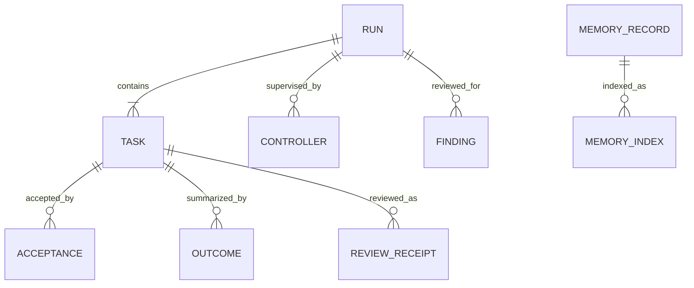
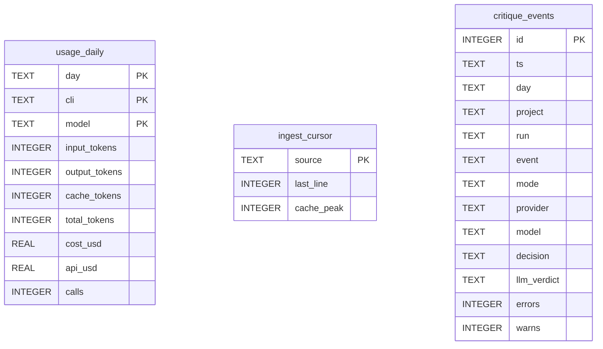

# Claude Lane Stack data model

TL;DR: Durable state is file-backed run/task contracts, receipts, findings, and memory records; local SQLite databases hold derived usage aggregates and a rebuildable memory search index (`schemas/run-v2.schema.json:1-71`, `bin/usage_ledger.py:492-553`, `bin/lane_memory.py:468-498`).

## Schema overview

Run and task contracts define dispatch intent; outcome, acceptance, controller, gate, review, and finding records capture execution evidence (`schemas/run-v2.schema.json:1-71`, `schemas/task-v2.schema.json:1-125`, `schemas/acceptance-v2.schema.json:1-40`, `schemas/outcome-v1.schema.json:1-82`). The board parses these artifacts into read-only projections (`board/server/lib/parsers.mjs:44-53`, `board/server/lib/parsers.mjs:416-451`).

## Run and task contracts

### `run.yaml` (schema v2)

Purpose: one run’s repository, base commit, risk/score, resource pools, gate policy, finalization policy, and workspace mode (`schemas/run-v2.schema.json:1-71`).

| Field | Meaning |
|---|---|
| `schema_version` | Contract version; this schema requires integer `2`. |
| `slug` | Run identifier and directory name. |
| `repo`, `project_cwd` | Repository identity and absolute project working directory. |
| `base_sha` | Git base commit for the run. |
| `created_at` | Contract creation timestamp. |
| `score`, `risk` | Planning score and declared risk; risk is an enum in the schema. |
| `pools` | Provider and verification worker pool configuration. |
| `gate` | Pre-merge gate policy and scope. |
| `finalize` | Merge/finalization mode and conditions. |
| `workspace` | Workspace strategy and worktree options. |

### Task YAML (schema v2)

Purpose: one task’s objective, ownership boundaries, dependencies, verification commands, and acceptance expectations (`schemas/task-v2.schema.json:1-125`).

| Field | Meaning |
|---|---|
| `schema_version` | Contract version; requires integer `2`. |
| `id`, `title` | Stable task key and human-readable work item. |
| `risk`, `lane` | Declared task risk and provider lane. |
| `project_cwd` | Project root used for execution. |
| `read_first`, `context_selectors` | Required reading and explicit source ranges selected for execution context. |
| `impact_receipt`, `impact_targets` | Project-relative impact evidence and exact owned path/symbol targets. |
| `interfaces`, `invariants`, `out_of_scope` | Compatibility boundaries, preserved conditions, and excluded work. |
| `expected_outputs` | Expected files or artifacts from the task. |
| `owns_paths`, `never_touch` | Allowed write paths and prohibited paths. |
| `depends_on` | Task IDs that must precede this task. |
| `objective` | Work objective text. |
| `acceptance` | Acceptance requirements. |
| `verify`, `verification` | Verification command forms and verification entries. |
| `skills` | Optional skill names injected into the task prompt. |

## Run receipts and review records

### Acceptance, outcome, and controller records

Purpose: machine-readable evidence for acceptance, terminal outcome, and run supervision. `run-validate` validates the acceptance schema before checking its task identity and evidence (`schemas/acceptance-v2.schema.json:1-40`, `schemas/outcome-v1.schema.json:1-82`, `schemas/run-controller-v1.schema.json:1-130`, `bin/run-validate:348-421`).

| Record | Fields and meanings |
|---|---|
| Acceptance | `schema_version` format; `task_id` and `task_sha256` bind the contract; `attempt` identifies attempt number; `provider_exit` records process result; `provider` and `model` identify execution; `report` and `report_sha256` identify output; `owns_check` records ownership evidence; `verification` records checks; `review` records review evidence; `accepted` is acceptance boolean; `accepted_at` is timestamp. |
| Outcome | `schema_version`; `task_id`, `run_dir`; `provider`, `model`, terminal `stage` (`accepted` or `blocked`); `exit_status`, `failure_class`, `last_status`; attempt and fallback counts; changed files, ownership violations, and `never_touch` hits; report path/hash; `updated_at` (`schemas/outcome-v1.schema.json:12-52`). |
| Controller | `schema_version`; `run_dir`, `project_cwd`; current `stage` (`running`, `accepted`, `blocked`, `failed`); `started_at`, `updated_at`, optional `completed_at`; `last_event`, `next_action`; summary `counts`; per-task `tasks` state (`schemas/run-controller-v1.schema.json:11-24`). |

| Lifecycle field | From | To | Writer and condition |
|---|---|---|---|
| Board status projection | accepted receipt | done | A receipt must match report hash, provider, model, ownership, verification, review, and acceptance fields (`board/server/lib/parsers.mjs:330-354`, `board/server/lib/parsers.mjs:412`). |
| Board status projection | starting / running / awaiting_verification / verifying / verified | running | Nonterminal runtime statuses map to the running column (`board/server/lib/parsers.mjs:54-60`). |
| Board status projection | stalled | stalled | A runtime `stalled` state maps to the stalled column (`board/server/lib/parsers.mjs:54-60`). |
| Board status projection | failed / cancelled / verification_failed / blocked | blocked | Terminal failure-like runtime statuses map to the blocked column (`board/server/lib/parsers.mjs:54-60`). |
| Board status projection | unknown / absent | pending | Unrecognized runtime labels fall through to pending (`board/server/lib/parsers.mjs:54-60`). |

The board chooses normalized task status from state and acceptance evidence, and merged runs can promote pending tasks to done (`board/server/lib/parsers.mjs:44-53`).

### Review and gate records

Purpose: preserve structured night-review findings, exact task re-review evidence, and gate evaluations (`schemas/finding-v1.schema.json:1-119`, `schemas/task-review-receipt-v2.schema.json:1-67`, `schemas/gate-event-v1.schema.json:1-31`).

| Record | Fields and meanings |
|---|---|
| Finding | `schema_version`; stable `fingerprint`; source commit/task/attempt/chunk; severity, title, summary, and actionable flag; evidence and scope; verification commands; status; first/last seen timestamps; closure data. |
| Task review receipt | `schema_version`, `receipt_type`; task ID/hash and attempt; project cwd and immutable base ref; hashes of reviewed diff and tree; verdict and findings; review timestamp. |
| Gate event | version `v`; timestamp `ts`; gate name and status; project/run/task IDs; scope; violations and never-touch matches; exit code and detail; provider and model. |
| Critique artifact | `schema_version`, engine, status (`pass`, `fail`, `ack`), decision, PM action, generation time, run directory, score, task count, summary, findings, model pass, and optional acknowledgement identity/note/time (`schemas/critique-v1.schema.json:10-24`). |
| Gate triage result | `schema_version`, summary, and typed findings. |
| Night review result | `schema_version`, chunk ID, verdict (`passed`, `failed`), and typed findings (`schemas/night-review-result-v1.schema.json:7-12`). |
| Gate event status | Per-evaluation outcome: `passed`, `rejected`, `failed`, or `skipped` (`schemas/gate-event-v1.schema.json:8-15`). |

| Lifecycle field | From | To | Writer and condition |
|---|---|---|---|
| Finding `status` | absent | open | Night review creates a canonical finding for each returned candidate (`schemas/finding-v1.schema.json:1-119`, `bin/night-review-engine:877-896`). |
| Finding `status` | fixed | open | A fresh reviewed recurrence of the same fingerprint clears prior closure and reopens it (`bin/night-review-engine:920-934`). |
| Finding `status` | open | needs_human | Invalid or overlapping ownership scope prevents safe task creation (`bin/night-review-engine:1135-1175`). |
| Finding `status` | unresolved | fixed | Repair completion records acceptance, review receipt, commit, and closure time (`bin/night-fix-runner:760-789`). |
| Finding `status` | open / needs_human / in_progress | dismissed | Jev triage sets non-actionable and dismissed when confidence is below `DISMISS_CUT` (`bin/jev_slots.py:12-59`). |
| Gate event `status` | evaluated | passed / rejected / failed / skipped | Gate logger appends one result per evaluation; events are append-only (`schemas/gate-event-v1.schema.json:8-15`, `bin/gate_log.py:1-45`). |
| Controller `stage` | not_started | running | Starting a new controller writes the running receipt (`bin/run-controller:700-719`). |
| Controller `stage` | running | accepted | All task stages are accepted (`bin/run-controller:327-337`, `bin/run-controller:442-448`). |
| Controller `stage` | running | degraded | Some tasks are blocked while other tasks remain nonterminal (`bin/run-controller:327-339`, `bin/run-controller:405-406`). |
| Controller `stage` | running | blocked | All task stages are terminal and at least one task is not accepted (`bin/run-controller:438-452`). |
| Controller `stage` | running | failed | Controller-level failure is persisted as failed (`bin/run-controller:766-799`). |

Controller task stages are `pending`, `retry_wait`, `running`, `awaiting_verification`, `owns_check`, `verifying`, `verification_running`, `accepting`, `accepted`, and `blocked` (`schemas/run-controller-v1.schema.json:79-113`).

| Task stage transition | From | To | Function and condition |
|---|---|---|---|
| Dispatch | pending | running | Dependencies accepted and provider slot available; controller starts `lane-ctl` (`bin/run-controller:1310-1367`). |
| Provider complete | running | awaiting_verification | Verification capacity is full (`bin/run-controller:1114-1130`). |
| Verification setup | running / awaiting_verification | owns_check | Controller starts the owned-path check (`bin/run-controller:1131-1151`). |
| Ownership pass | owns_check | verifying | Owned-path check succeeds and verification starts (`bin/run-controller:839-845`, `bin/run-controller:870-875`). |
| Verification pass | verifying / verification_running | accepting | Verification succeeds and acceptance starts (`bin/run-controller:945-969`, `bin/run-controller:951-968`). |
| Retry | retry_wait | running | Retry delay expires and `lane-ctl retry` starts (`bin/run-controller:1015-1057`). |
| Acceptance | accepting | accepted | `lane-ctl accept` returns an accepted result (`bin/run-controller:972-1009`). |
| Failure | any active stage | blocked | Dependency, ownership, contract, or exhausted retry conditions block the task (`bin/run-controller:350-406`, `bin/run-controller:1173-1195`). |

## Usage ledger database

The usage ledger is stored at `~/.agents/usage/usage.sqlite`; its tables are created and migrated by `connect` (`bin/usage_ledger.py:492-553`).

| Table | Column | Meaning |
|---|---|---|
| `usage_daily` | `day` | ISO day key used for aggregation. |
|  | `cli` | CLI/provider category attached to recorded usage. |
|  | `model` | Model identifier; empty string is the default unknown value. |
|  | `input_tokens`, `output_tokens`, `cache_tokens`, `total_tokens` | Token counts for the aggregate day/CLI/model row. |
|  | `cost_usd`, `api_usd` | USD cost and estimated/API cost values. |
|  | `calls` | Number of usage events merged into the row. |
| `ingest_cursor` | `source` | Transcript or receipt source key. |
|  | `last_line` | Number of source lines consumed. |
|  | `cache_peak` | Highest cache working-set count seen for that source. |
| `critique_events` | `id` | Auto-increment event key. |
|  | `ts`, `day` | Event timestamp and ISO day. |
|  | `project`, `run` | Project and run identity strings. |
|  | `event` | Event name. |
|  | `mode`, `provider`, `model` | Critique mode and execution identity. |
|  | `decision`, `llm_verdict` | Structured critique decision and model verdict. |
|  | `errors`, `warns` | Counts of error and warning findings. |

Usage writers aggregate token and cost counters on `(day, cli, model)` conflicts, while readers return rows by day or across all days (`bin/usage_ledger.py:700-730`, `bin/usage_ledger.py:1019-1029`). Transcript ingestion advances `ingest_cursor`; daily reconstruction deletes that day’s usage rows and recreates transcript/receipt-derived data (`bin/usage_ledger.py:810-835`, `bin/usage_ledger.py:850-881`). No automatic retention deletion appears in these writer/read paths.

`record_critique_event` and `record_critique_result` append critique and dispatch events; `critique_follow_stats` reads those events to count whether advised revisions were followed (`bin/usage_ledger.py:567-675`). `usage_daily` is written by provider transcript/receipt ingestion and read by usage summaries; `ingest_cursor` is written during incremental source ingestion and read to resume the source scan (`bin/usage_ledger.py:810-835`, `bin/usage_ledger.py:940-965`, `bin/usage_ledger.py:1019-1029`).

## Project memory records and search index

The memory integration resolves the project on the BB host, calls Lane Pilot session-memory RPCs, and uses the local corpus when hub mode is disabled or unavailable (`bin/lane_memory_hub.py:65-88`, `bin/lane_memory_hub.py:100-123`, `bin/lane_memory.py:412-417`). Shared hub records have no local SQLite schema in this repository; the client queues failed writes as JSON in `.cls/memory-outbox/` and flushes in filename order until the first failed send (`bin/lane_memory_hub.py:125-154`).

Memory records in local mode are Markdown files with structured frontmatter; `status` is constrained to draft, active, superseded, revoked, expired, or archived (`bin/lane_memory.py:31-45`, `bin/lane_memory.py:54-70`). Active, trusted, audience-eligible records are used for retrieval (`bin/lane_memory.py:345-367`, `bin/lane_memory.py:385-394`).

| Field | Meaning |
|---|---|
| `id` | Stable record key and filename stem; writer restricts characters (`bin/lane_memory.py:400`, `bin/lane_memory.py:1206-1210`). |
| `schema_version` | Record format version; current writer requires version 2 (`bin/lane_memory.py:53-62`, `bin/lane_memory.py:955-956`). |
| `status` | Draft, active, superseded, revoked, expired, or archived lifecycle label (`bin/lane_memory.py:31-34`). |
| `memory_type`, `truth_mode` | Closed-vocabulary fact category and epistemic mode (`bin/lane_memory.py:15-29`, `bin/lane_memory.py:1200-1201`). |
| `claim` | One concise statement; observed claims require evidence (`bin/lane_memory.py:1202-1205`, `bin/lane_memory.py:1216-1218`). |
| `language` | Record language, restricted to `en` or `ru` (`bin/lane_memory.py:104`, `bin/lane_memory.py:953-954`). |
| `source` | Claim provenance, including authority (`bin/lane_memory.py:72-76`). |
| `evidence` | Supporting references; required for `truth_mode: observed` (`bin/lane_memory.py:74-76`, `bin/lane_memory.py:1216-1218`). |
| `risk` | Risk label; inferred from sensitivity and verification when absent (`bin/lane_memory.py:1219-1226`). |
| `sensitivity` | Public/internal/sensitive/encrypted-required handling class; selects local or shared storage (`bin/lane_memory.py:35-37`, `bin/lane_memory.py:1227-1235`). |
| `context_priority` | `always` marks core context; other records are retrieved on demand (`bin/lane_memory.py:79-82`, `bin/lane_memory.py:1252-1259`). |
| `retrieval.areas`, `retrieval.hint` | Search facets and synonyms indexed for retrieval (`bin/lane_memory.py:80-82`, `bin/lane_memory.py:370-382`). |
| `verification.command` | Optional validation command; its presence contributes to inferred risk (`bin/lane_memory.py:83-84`, `bin/lane_memory.py:1219-1225`). |
| `supersedes`, `superseded_by` | Replacement link to the predecessor and generated reverse link (`bin/lane_memory.py:1267-1284`). |
| `valid_from`, `valid_until` | Date window for retrieval eligibility (`bin/lane_memory.py:345-361`). |

The per-project `memory-lexical.sqlite` index has one table, `mem_axis(rid, body)`. In FTS5 mode it is a virtual table; fallback mode defines `rid` as primary key and `body` as tokenized searchable text (`bin/lane_memory.py:468-498`). `rid` is the source memory record ID; `body` indexes ID, claim, retrieval hint/areas, and memory type (`bin/lane_memory.py:370-382`). This index is derived and rebuilt when the corpus hash is stale (`bin/lane_memory.py:461-510`).

| `status` transition | From | To | Function and condition |
|---|---|---|---|
| Record write | author-supplied status | persisted status | Writer requires status and checks its vocabulary; it does not infer or activate the status (`bin/lane_memory.py:1195-1201`, `bin/lane_memory.py:1267-1284`). |
| Supersession | active | superseded | Replacing a prior rule updates the prior record’s status (`bin/lane_memory.py:1270-1285`). |
| Forget | stored | expired | `forget(..., mode="expire")` writes expired status (`bin/lane_memory.py:1331-1355`). |
| Archive | stored | archived | `forget(..., mode="archive")` writes archived status (`bin/lane_memory.py:1331-1355`). |
| Erase | any stored record | removed | `forget(..., mode="erase", yes=True)` unlinks the Markdown record, rebuilds the index, and checks for leftover traces (`bin/lane_memory.py:1331-1345`). |

**Invariants and ownership.** In local mode, Markdown records are authoritative and the index stores only tokenized retrieval fields that can be rebuilt (`bin/lane_memory.py:468-498`). Owner memory indexing excludes records whose sensitivity is `sensitive` or `encrypted-required` (`bin/lane_memory.py:427-430`). `lane_memory.py` resolves hub-first storage/search and handles local records and index fallback; `lane_memory_hub.py` resolves the project ID, calls remote RPC, and queues failed writes (`bin/lane_memory.py:412-417`, `bin/lane_memory.py:634-680`, `bin/lane_memory_hub.py:100-118`, `bin/lane_memory_hub.py:137-165`). Memory cleanup in local mode is explicit through expire, archive, or erase; expired and archived records remain as files (`bin/lane_memory.py:1331-1355`).

## Retention and cleanup

Usage reconstruction is day-scoped and replaces that day’s aggregate rows; no retention job for usage rows or critique events is defined in `usage_ledger.py` (`bin/usage_ledger.py:850-881`, `bin/usage_ledger.py:567-675`). Memory `expire` and `archive` retain the record with a terminal status; `erase` removes it and rebuilds derived state (`bin/lane_memory.py:1331-1355`). Successful hub outbox writes are unlinked, malformed queue files are discarded, and a failed send leaves the current and later entries queued; this client defines no remote-record retention schedule (`bin/lane_memory_hub.py:137-154`). Run artifacts are created in project `.agents/runs/<slug>/` directories and remain file-backed; the contract schemas do not define a cleanup schedule (`bin/run-init:185-270`, `schemas/run-v2.schema.json:1-71`).

<!-- lane-pilot:backlinks -->
## Referenced by

- [Beginner guide](BEGINNER.ru.md)
- [Project memory pack](PROJECT-MEMORY.md)
- [Claude Lane Stack architecture](architecture.md)
- [Claude Lane Stack overview](overview.md)
